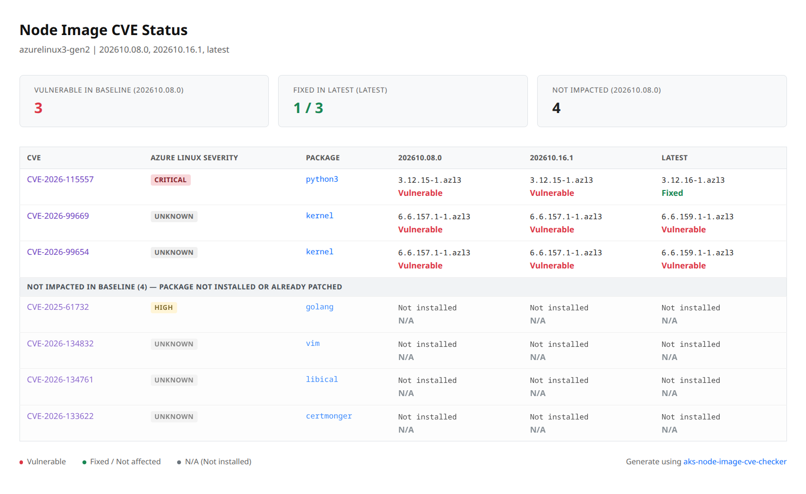

# AKS Node Image CVE Checker

Check AKS **Ubuntu** and **Azure Linux 3** node image package inventories for CVEs using AgentBaker VHD build logs.

> **Scope:** Reads apt/dpkg and RPM package lists from published VHD build logs — it does not mount VHDs, inspect running nodes, or scan standalone binaries (such as `/opt/bin/*`) and container images.

## Quick Start

### Local
```bash
curl -O https://raw.githubusercontent.com/m8yng/aks-troubleshooters/main/aks-node-image-cve-checker/aks-node-image-cve-checker.py
pip install requests rpm-vercmp
python3 ./aks-node-image-cve-checker.py
```

### Docker / Podman (one-liner)
```bash
docker run --rm -v "$PWD:/out" python:3.14-slim-trixie bash -c "
  apt update -qq && apt install -y -qq curl > /dev/null 2>&1 && \
  curl -sO https://raw.githubusercontent.com/m8yng/aks-troubleshooters/main/aks-node-image-cve-checker/aks-node-image-cve-checker.py && \
  pip install -q requests rpm-vercmp && \
  python3 ./aks-node-image-cve-checker.py \
    -t azurelinux3-gen2 \
    --cve-list 'CVE-2026-99669,CVE-2026-99654' \
    --compare 202604.13.0,latest \
    --html /out/cve-report.html
"
```
*(For rootless Podman with SELinux, replace `docker` with `podman` and use `-v "$PWD:/out:Z"`.)*

## Common Workflows

### 1. Full image scan
```bash
# Latest Ubuntu 24.04 (default) or 22.04
python3 aks-node-image-cve-checker.py
python3 aks-node-image-cve-checker.py -t 2204containerd

# Latest Azure Linux 3 Gen2
python3 aks-node-image-cve-checker.py -t azurelinux3-gen2

# Filter by minimum severity or package name
python3 aks-node-image-cve-checker.py -t azurelinux3-gen2 -s high -p openssl,kernel

# Scan a local VHD build log or export JSON
python3 aks-node-image-cve-checker.py ./vhd-build-log.txt -t azurelinux3-gen2 -o report.json
python3 aks-node-image-cve-checker.py -j | jq .
```

### 2. Check specific CVEs on one image
```bash
python3 aks-node-image-cve-checker.py -t 2204containerd --cve-list "CVE-2026-35385"
python3 aks-node-image-cve-checker.py -t azurelinux3-gen2 --cve-list "CVE-2026-99669,CVE-2026-134832"
```

### 3. Compare CVEs across image versions (+ HTML report)
First version in `--compare` is the **baseline**; only CVEs vulnerable (or unknown on Azure Linux) in baseline are shown.

```bash
python3 aks-node-image-cve-checker.py \
  -t 2204containerd \
  --cve-list "CVE-2026-3497,CVE-2026-35385,CVE-2026-40706" \
  --compare 202604.13.0,202604.24.0,latest \
  --html cve_report.html
```

`--cve-list` accepts inline comma-separated IDs or a file path containing comma-separated CVE IDs.



## Supported Image Types (`-t`)

| OS | Image types |
|---|---|
| **Ubuntu** | `2404containerd` *(default)*, `2404arm64containerd`, `2404cvmcontainerd`, `2404tlcontainerd`, `2204containerd`, `2204arm64containerd`, `2204tlcontainerd`, `2004cvmcontainerd`, `2004fipscontainerd` |
| **Azure Linux 3** | `azurelinux3-gen2`, `azurelinux3-gen2arm64`, `azurelinux3-gen2fips`, `azurelinux3-gen2arm64fips`, `azurelinux3-gen2tl`, `azurelinux3-gen2kata`, `azurelinux3-gen2katacc`, `azurelinux3-cvmgen2`, `azurelinux3-osguardgen2fipstl`, `azurelinux3-gen1`, `azurelinux3-gen1fips` |

*(Azure Linux 2 / CBL-Mariner 2 and Azure Container Linux are not supported.)*

## CLI Options

| Option | Description |
|---|---|
| `build_log` | Local VHD build log to parse (auto-downloads from AgentBaker if omitted) |
| `-t, --type` | Image type (default: `2404containerd`) |
| `-i, --image-version` | Specific image version, e.g. `202604.13.0` (default: `latest`) |
| `-p, --package-names` | Filter packages by substring (comma-separated) |
| `-s, --security-level` | Minimum severity: `critical`, `high`, `medium`, `low`, `negligible` |
| `--cve-list` | Comma-separated CVE IDs or path to file |
| `--compare` | Comma-separated versions to compare (`baseline,v2,latest`) |
| `--html` | Save HTML comparison report (used with `--compare`) |
| `-o, --output` | Save JSON report to file |
| `-j, --json` | Print JSON report to stdout |
| `-r, --refresh` | Re-download cached build logs and vulnerability feeds |
| `--osv-data` | Override Azure Linux OSV `all.zip` or `osv/` path (auto-cached by default) |

## Data Sources & Cache

| OS | Build logs | Vulnerability data | Severity |
|---|---|---|---|
| **Ubuntu** | [AgentBaker `AKSUbuntu`](https://github.com/Azure/AgentBaker/tree/master/vhdbuilder/release-notes/AKSUbuntu) | [OSV API](https://google.github.io/osv.dev/api/) | Ubuntu priority |
| **Azure Linux 3** | [AgentBaker `AKSAzureLinuxV3`](https://github.com/Azure/AgentBaker/tree/master/vhdbuilder/release-notes/AKSAzureLinuxV3) | [AzureLinuxVulnerabilityData OVAL](https://github.com/microsoft/AzureLinuxVulnerabilityData) *(patched)* + [OSV `Azure Linux/all.zip`](https://osv-vulnerabilities.storage.googleapis.com/Azure%20Linux/all.zip) *(unpatched)* | Microsoft OVAL severity / CVSS v3 |

All downloaded logs and feeds are cached in `./script_cache/`. Pass `-r` to refresh.
